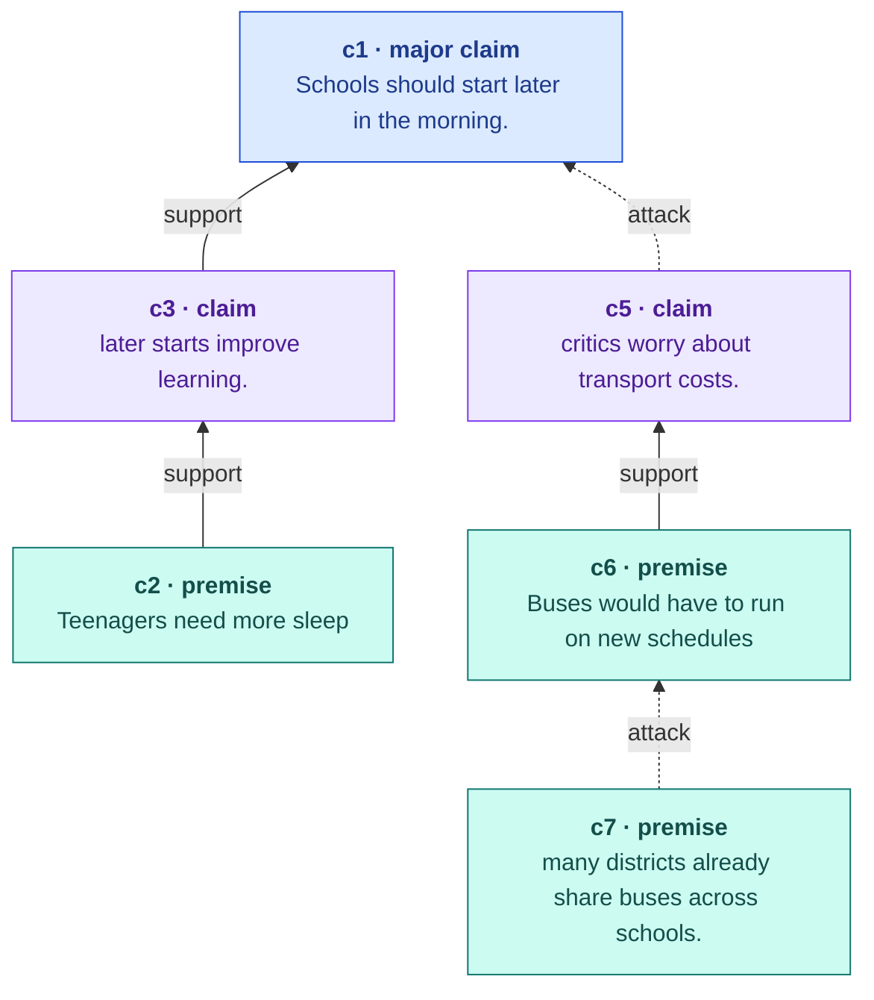
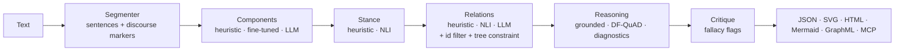

# argmine-agent

[](https://github.com/islem1213/Argument-Mining-Agent/actions/workflows/ci.yml)


> Open-source pipeline that turns prose into an inspectable **argument graph** — claims, premises, support/attack relations — and then reasons over it with formal argumentation semantics.

`argmine-agent` combines cheap, deterministic components (discourse-aware segmentation and heuristics), optional local models (a fine-tuned classifier, an NLI cross-encoder) and optional LLM judges with validated structured output. Every backend produces the same typed graph, so you can start offline and swap in stronger models stage by stage.



*Excerpt of [`sample_outputs/school_start_times.mmd`](sample_outputs/school_start_times.mmd), produced offline by the default heuristic backends. Open [`school_start_times.html`](sample_outputs/school_start_times.html) for the interactive report.*

## What's new in v0.2

- **Discourse-aware segmentation.** Markers such as *because*, *so*, *however* and *but* are kept as metadata instead of being thrown away, and drive both component typing and relation direction ("A, so B" ⇒ A supports B; "X, but Y" ⇒ Y attacks X). Abbreviations and decimals no longer split sentences.
- **Three interchangeable backends per stage** — heuristic, local NLI (no API, CPU-friendly) and LLM — behind one typed Pydantic schema.
- **Provider-agnostic LLM judge with structured output.** JSON Schema `response_format` derived from the Pydantic models, automatic fallback to `json_object` for servers that lack it, a self-repair retry on invalid JSON, and filtering of hallucinated ids. Works with OpenAI, Mistral, Groq or a local Ollama / vLLM server.
- **Formal argumentation layer.** Dung's *grounded semantics* labels each component `in` / `out` / `undec`, and *DF-QuAD* gradual semantics gives a strength in [0, 1] over supports and attacks. Diagnostics report the central claim, unsupported claims and isolated statements.
- **Fallacy flags** from a fixed taxonomy (heuristic cues or an LLM judge).
- **MCP server** so any agent (Claude Desktop/Code, Cursor, VS Code, your own LangGraph agent) can call `mine_arguments`, `critique_argument` and `argument_map` as tools.
- **New exports:** layered SVG with typed edges, Mermaid (renders on GitHub), and a self-contained interactive HTML report that links the graph to highlighted source text.
- **Reproducible evaluation:** AAEC/brat converter, span-aligned component and relation F1 (v0.1 compared relations by node id, which only works when ids coincide), batch JSONL mode.
- Tests (22), Ruff and GitHub Actions on Python 3.10–3.13; Python 3.10 compatibility fixed (v0.1 used `enum.StrEnum`, which requires 3.11).

## Architecture



## Quickstart

Requires Python 3.10+.

```bash
git clone https://github.com/islem1213/Argument-Mining-Agent.git
cd Argument-Mining-Agent
python -m venv .venv && source .venv/bin/activate   # Windows: .venv\Scripts\Activate.ps1
python -m pip install -e .

argmine --file examples/school_start_times.txt --fallacies heuristic \
  --html report.html --image map.svg --mermaid map.mmd
```

The command prints a summary table, writes the graph JSON, and opens nothing by itself — `report.html` is a single file you can open in any browser. Text can also be passed as an argument or piped on stdin.

```python
from argmine import ArgumentMiner, PipelineConfig

graph = ArgumentMiner(PipelineConfig(fallacies="heuristic")).mine(text)
graph.analysis.central_claim, graph.analysis.unsupported_claims
```

## Backends

| Stage | `heuristic` (default) | Local model | LLM |
| --- | --- | --- | --- |
| Components | discourse markers + lexical cues | `--classifier-model PATH_OR_HF_ID` (fine-tuned) | `--components llm` |
| Stance | lexicon + markers | `--stance nli` | — |
| Relations | marker rules + nearest claim | `--relation-backend nli` | `--relation-backend llm` |
| Fallacies | `--fallacies heuristic` (cue spotting, confidence ≤ 0.4) | — | `--fallacies llm` |

```bash
pip install -e '.[nli]'   # transformers + torch, CPU is fine (default: cross-encoder/nli-deberta-v3-small)
pip install -e '.[llm]'   # any OpenAI-compatible endpoint

# Fully self-hosted LLM judge with Ollama
export ARGMINE_LLM_BASE_URL=http://localhost:11434/v1 ARGMINE_LLM_MODEL=qwen2.5:7b-instruct
argmine --file essay.txt --components llm --relation-backend llm --fallacies llm

# Hosted provider (Mistral shown; OpenAI, Groq etc. work the same way)
export ARGMINE_LLM_BASE_URL=https://api.mistral.ai/v1 ARGMINE_LLM_API_KEY=... ARGMINE_LLM_MODEL=mistral-small-latest
```

Candidate relation pairs are restricted to a local window (`--relation-window`, default 2) plus every claim → major claim, and by default each component keeps a single outgoing edge, as in the persuasive-essay scheme (`--no-tree` disables this).

## Use it from an agent (MCP)

```bash
pip install -e '.[mcp]'
argmine-mcp                 # stdio
argmine-mcp --http          # streamable HTTP on 127.0.0.1:8765
```

Add it to an MCP client, for example Claude Desktop's `claude_desktop_config.json`:

```json
{
  "mcpServers": {
    "argmine": {
      "command": "argmine-mcp",
      "env": { "ARGMINE_RELATION_BACKEND": "heuristic" }
    }
  }
}
```

Tools: `mine_arguments(text, topic?)` → graph JSON, `critique_argument(text, topic?)` → feedback report, `argument_map(text, topic?)` → Mermaid diagram.

## Reasoning over the graph

Mining tells you what the structure is; the reasoning layer tells you what follows from it.

- **Grounded semantics** (Dung, 1995) uses attacks only. In the sample essay the thesis `c1` is `out`: the counter-claim `c5` attacks it and nothing in the text attacks `c5` itself (the rebuttal `c7` targets its premise instead). That is precisely the kind of gap an essay-feedback tool should surface.
- **DF-QuAD** (Rago et al., 2016) is gradual and bipolar: `c1` still has strength 0.67 because two supported claims outweigh one attack.

## Evaluation

Scores are only comparable when the dataset split, preprocessing and metric match, so nothing is reported until it has been run on a licensed split.

```bash
# 1. Convert the Argument Annotated Essays v2 corpus (download it from TU Darmstadt; not redistributed here)
python -m argmine.data.brat data/raw/ArgumentAnnotatedEssays-2.0/brat-project-final \
  --split data/raw/ArgumentAnnotatedEssays-2.0/train-test-split.csv --out data/processed

# 2. Score any configuration directly on the gold texts
argmine-eval --gold data/processed/graphs_test.jsonl --run --relation-backend heuristic

# 3. Or score saved predictions (e.g. from `argmine --batch`)
argmine-eval --gold data/processed/graphs_test.jsonl --predictions preds.jsonl --match exact
```

The report contains span F1, per-label and macro component F1, typed relation F1 and untyped link F1. Predicted components are aligned to gold spans by character overlap (≥ 50 % of the longer span, or exact with `--match exact`) before relations are compared. Record each run in [`eval/results.md`](eval/results.md).

Train the component classifier on the converted split (`--with-context` passes the surrounding paragraph as a second segment):

```bash
pip install -e '.[train]'
python -m argmine.components.train --train data/processed/components_train.jsonl \
  --validation data/processed/components_test.jsonl --output weights/pe-deberta \
  --base-model microsoft/deberta-v3-base --with-context
argmine --file essay.txt --classifier-model weights/pe-deberta
```

For a publishable number, hold out a validation set from the training essays instead of selecting checkpoints on the test split.

## Output format

```jsonc
{
  "schema_version": "0.2",
  "nodes": [{"id": "c2", "text": "Teenagers need more sleep", "start": 43, "end": 68,
             "label": "premise", "stance": "neutral", "sentence": 1, "confidence": 0.6}],
  "edges": [{"source": "c2", "target": "c3", "type": "support", "confidence": 0.65,
             "rationale": "followed by conclusion marker 'so'"}],
  "analysis": {"components": {"c1": {"grounded": "out", "strength": 0.67, "supporters": 2, "attackers": 1}},
               "central_claim": "c1", "unsupported_claims": [], "isolated_components": [], "fallacies": []},
  "metadata": {"relation_backend": "heuristic", "elapsed_ms": "2"}
}
```

Offsets always index the original text. Spans exclude the leading discourse marker, which is stored in `marker`, matching the AAEC convention.

## Design choices

- **Hybrid by stage, not by document.** Component typing is a recurring structural decision where a supervised model is cheap and deterministic; relation judgement depends on local semantics, where NLI or an LLM helps. Each stage can be upgraded independently, and regression tests stay meaningful.
- **The schema is the contract.** LLM output is never trusted directly: it is validated against Pydantic models, ids outside the candidate set are dropped, and structural constraints are applied after every backend.
- **Offline first.** The default configuration needs only `pydantic` and `networkx`, runs in milliseconds and is fully reproducible.

## Limitations

- The heuristic backends are a transparent baseline, not a state-of-the-art system; segmentation errors propagate downstream.
- Heuristic fallacy flags are cue-based and low precision — treat them as prompts for a second look.
- Cross-document argument mining and calibrated confidence remain future work.

## Repository layout

```text
argmine/            package: segmenter, components/, stance, relations, reasoning, critique,
                    export, llm, nli, pipeline, cli, mcp_server, evaluate, data/brat
eval/               results log (+ v0.1 `python -m eval.benchmark` entry point)
tests/              pytest suite (LLM and NLI backends are stubbed, no network needed)
examples/           input documents
sample_outputs/     JSON, SVG, HTML, Mermaid and GraphML produced from the examples
notebooks/          walkthrough
```

## References

```bibtex
@article{stab-gurevych-2017-parsing,
  title   = {Parsing Argumentation Structures in Persuasive Essays},
  author  = {Stab, Christian and Gurevych, Iryna},
  journal = {Computational Linguistics},
  volume  = {43}, number = {3}, pages = {619--659}, year = {2017}
}
@article{dung-1995,
  title   = {On the acceptability of arguments and its fundamental role in nonmonotonic reasoning,
             logic programming and n-person games},
  author  = {Dung, Phan Minh},
  journal = {Artificial Intelligence}, volume = {77}, number = {2}, pages = {321--357}, year = {1995}
}
@inproceedings{rago-2016-dfquad,
  title     = {Discontinuity-Free Decision Support with Quantitative Argumentation Debates},
  author    = {Rago, Antonio and Toni, Francesca and Aurisicchio, Marco and Baroni, Pietro},
  booktitle = {Proceedings of KR}, year = {2016}
}
```

Please also cite the specific model, dataset release and prompt/model version used in an experiment.
