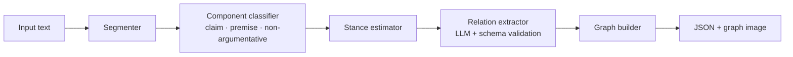

# argmine-agent

> Open-source pipeline for extracting argumentative structure from text, combining a fine-tuned classifier with LLM-based relation extraction.

`argmine-agent` turns prose into an inspectable argument graph: components are segmented and labelled, their stance is estimated, and their semantic relationships are represented as typed edges.

## Motivation

Argument mining makes the reasoning in a document legible to both people and downstream systems. It can support debate analysis, feedback and essay scoring, and fact-checking workflows by surfacing claims, evidence, and conflicts rather than treating a document as undifferentiated text. This project is a practical, reproducible implementation informed by the persuasive-essay argument-mining literature; it does not claim to supersede its research benchmarks.

## Architecture



The default implementation is fully local and deterministic. Add `--classifier-model path-or-hf-id` to use a fine-tuned DistilBERT/RoBERTa classifier. Install the optional LLM extra, set `OPENAI_API_KEY` (or `ARGMINE_LLM_BASE_URL` for an OpenAI-compatible self-hosted endpoint), and select `--relation-backend llm` to use a structured relation judge. Candidate pairs are constrained to a local ADU window; validated JSON remains the contract between that step and the graph builder.

## Quickstart

Requires Python 3.10+.

```bash
git clone <your-fork-url>
cd argmine-agent
python -m venv .venv
python -m pip install -e .
argmine "Schools should start later. Teenagers need more sleep, so later starts improve learning." \
  --output sample_outputs/quickstart.json --image sample_outputs/quickstart.svg \
  --graphml sample_outputs/quickstart.graphml --relation-window 2
```

On Windows, activate the environment with `.venv\Scripts\Activate.ps1`; if `python` is not on PATH, use `py -3`. Install LLM support with `python -m pip install -e .[llm]`. The command writes an interoperable graph JSON document and a standalone SVG preview. Try the included input with `argmine --file examples/school_start_times.txt`.

## Benchmark results

We keep evaluation separate from the demo path: it is only meaningful when run against the exact dataset split and annotation conversion specified by the dataset. `python -m eval.benchmark --gold ... --predictions ...` reports component and relation F1 from JSONL files.

| Task | This repository | Published reference | Notes |
| --- | ---: | ---: | --- |
| Component classification (macro F1) | Not yet reported | Dataset-dependent | Run `eval.benchmark` on the licensed split. |
| Relation identification (F1) | Not yet reported | Dataset-dependent | Report exact split, labels, and preprocessing. |

No performance numbers are fabricated in this starter repository. Once weights and a licensed dataset split are added, record the command, commit hash, seed, and metric definition in [`eval/results.md`](eval/results.md).

Train the optional component model from a converted PE/AAEC JSONL split:

```bash
python -m pip install -e .[train]
python -m src.component_classifier.train \
  --train data/processed/train.jsonl --validation data/processed/validation.jsonl \
  --output src/component_classifier/weights/pe-distilbert
```

## Design choices

The hybrid boundary is intentional. A supervised component classifier is inexpensive and deterministic for recurring structural labels, which makes it suitable for batch use and regression testing. Relation judgement depends more heavily on local semantics and discourse context, where an LLM can be useful. Schema validation, a strict edge vocabulary, and a local fallback make that semantic step auditable instead of opaque.

## Limitations and future work

- Segmentation mistakes propagate to every downstream stage.
- Long documents need chunking and cross-chunk relation resolution.
- The included baseline is deliberately lightweight; released weights should be trained and evaluated on a licensed dataset split.
- Cross-document argument mining, source attribution, and calibrated uncertainty are future work.

## Citation

If you use a persuasive-essay dataset or its annotation scheme, cite its original source:

```bibtex
@inproceedings{stab-gurevych-2017-parsing,
  title={Parsing Argumentation Structures in Persuasive Essays},
  author={Stab, Christian and Gurevych, Iryna},
  booktitle={Computational Linguistics},
  year={2017}
}
```

Please also cite the specific model, dataset release, and prompt/model version used for your experiment.

## Repository layout

```text
data/             raw and processed datasets (not versioned when licensed)
src/              pipeline implementation
eval/             reproducible metrics and result records
notebooks/        sample walkthrough
examples/         input documents
sample_outputs/   JSON and SVG argument graphs
```
